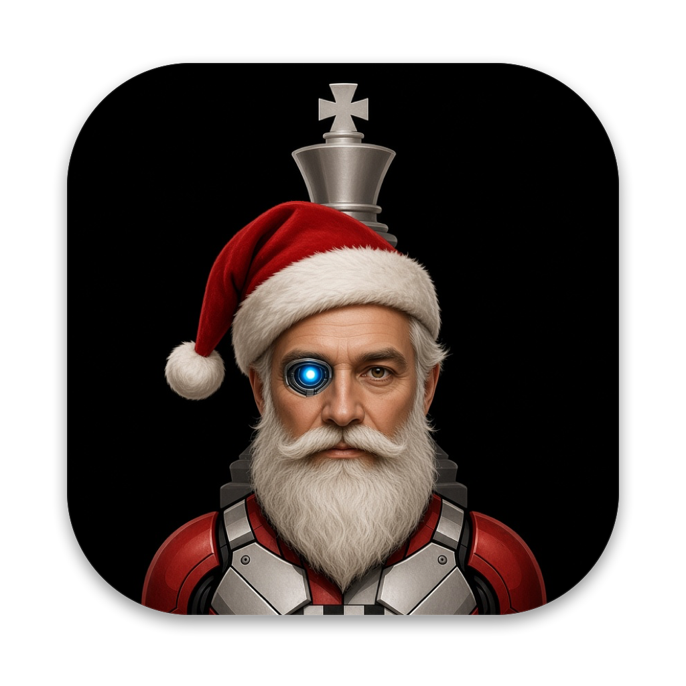

<p align="center"></p>

# Grandie Chess

A chess training app for macOS, powered by [Leela Chess Zero](https://lczero.org).

- **Play** human-like [Maia](https://maiachess.com) opponents (1100–2200) and Leela at eight calibrated strengths, with clocks, hints and takebacks.
- **Review** every game automatically: accuracy, mistakes and blunders, the better move, and "retry this position".
- **Analyse** with lc0 and any UCI engine (one-click Stockfish), multiple lines, an evaluation bar and graph.
- **Keep a database** of your games: import from Lichess, Chess.com and PGN files; filter and search by exact position or piece pattern.
- **Train openings** with an explorer (your games, Lichess, Masters) and a repertoire drilled with spaced repetition (FSRS).
- **Solve puzzles** from the Lichess puzzle database with a Glicko-2 puzzle rating.
- **Track progress**: strength against each level, accuracy over time, weakest openings.

Built with [Tauri 2](https://tauri.app) (Rust) and React. lc0 runs as a bundled helper process on the Mac's GPU through Metal.

## Install

Download the latest `.dmg` from [Releases](https://github.com/Inad-Tech-World/grandie_chess/releases). Until builds are signed with an Apple Developer ID, macOS asks you to approve the app once: open it, then go to **System Settings → Privacy & Security → Open Anyway**.

Requires macOS 13 or later, on Apple Silicon or Intel.

## Build from source

You need Xcode (or its command-line tools), Python 3, Rust (stable, 1.97 or later), Node.js 22.12 or later, and pnpm.

```sh
git clone --recurse-submodules https://github.com/Inad-Tech-World/grandie_chess.git
cd grandie_chess
engine/build-lc0.sh          # builds lc0 for this Mac (installs Meson/Ninja into engine/.venv)
pnpm install
pnpm tauri dev               # run the app in development mode
```

Other useful commands:

| Command | What it does |
|---|---|
| `engine/build-lc0.sh --universal` | Build lc0 for Apple Silicon and Intel and join them |
| `engine/build-lc0.sh --prebuilt` | Use the official universal lc0 v0.32.0 binary instead of building |
| `pnpm test` | Frontend unit tests (Vitest) |
| `pnpm e2e` | End-to-end UI tests in Chromium against a mock backend (Playwright) |
| `cd src-tauri && cargo test --workspace` | Rust tests, including games against a scripted fake engine |
| `cd src-tauri && cargo fmt --all && cargo clippy --workspace --all-targets` | Format and lint the Rust code (CI rejects any warning) |
| `cd src-tauri && cargo test --test lc0_real -- --ignored` | Tests against the real lc0 and downloaded networks |
| `cd src-tauri && cargo run --profile perf -p grandie-dev-tools --bin calibrate -- --a leela-4 --b maia-1500` | Estimate an opponent level's rating with engine matches |
| `pnpm tauri build --target universal-apple-darwin` | Build the universal app and DMG |

See [`engine/BENCHMARKS.md`](engine/BENCHMARKS.md) for engine speed on an Intel Mac, and [`docs/RELEASING.md`](docs/RELEASING.md) for signing, notarisation and auto-updates.

## Project layout

| Path | Contents |
|---|---|
| `engine/` | lc0 (git submodule) and its build script |
| `src-tauri/src/engine/` | UCI process manager, lc0 configuration, network catalogue, backend benchmark |
| `src-tauri/src/game/` | Rules (shakmaty), play sessions, clocks, PGN, opening names |
| `src-tauri/src/analysis/` | Live analysis, game review, accuracy and move classification |
| `src-tauri/src/db/` | SQLite game database, import, position search, explorer |
| `src-tauri/src/training/` | Repertoire, spaced repetition, puzzles, Glicko-2, progress |
| `src-tauri/src/net/` | Downloads, Lichess and Chess.com APIs |
| `src/` | React UI |
| `tests/e2e/` | Playwright tests |

## Licence

GPL-3.0-or-later. See [`LICENSE`](LICENSE) and [`CREDITS.md`](CREDITS.md) for the licences of everything Grandie Chess builds on.
