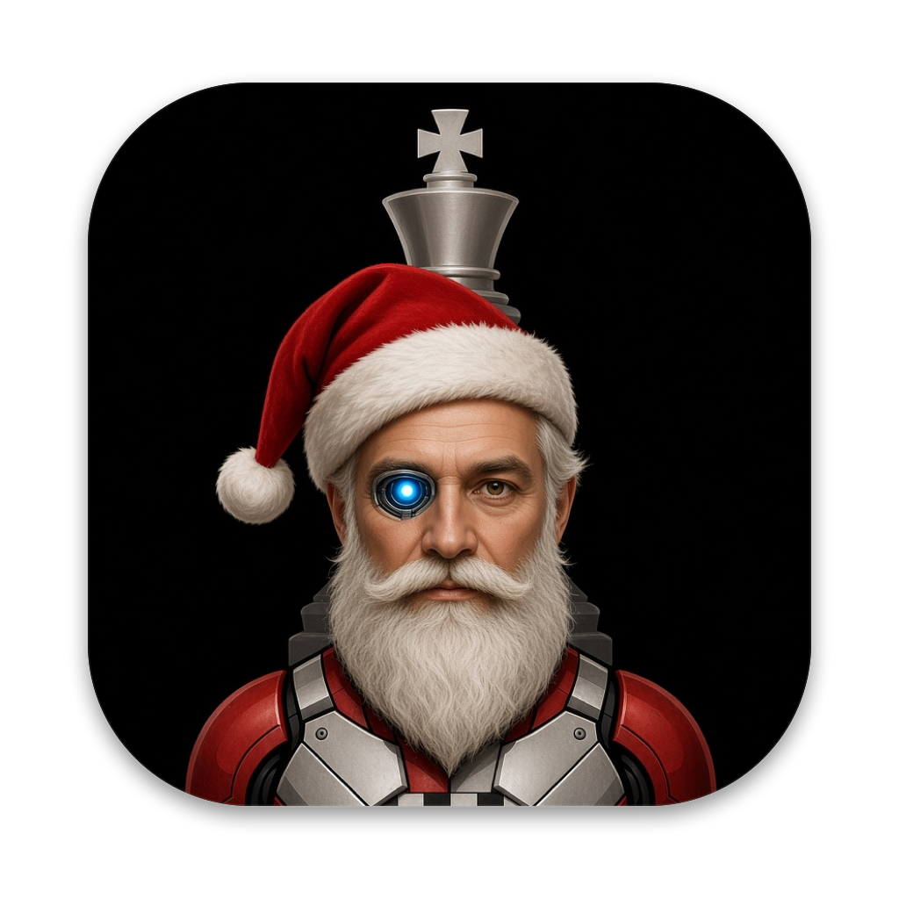

<p align="center"></p>

# Grandie Chess

A chess training app for macOS and Windows, powered by [Leela Chess Zero](https://lczero.org).

- **Play** human-like [Maia](https://maiachess.com) opponents (1100–2200) and Leela at eight calibrated strengths, with clocks, hints and takebacks.
- **Review** every game automatically: accuracy, mistakes and blunders, the better move, and "retry this position".
- **Analyse** with lc0 and any UCI engine (one-click Stockfish), multiple lines, an evaluation bar and graph.
- **Keep a database** of your games: import from Lichess, Chess.com and PGN files; filter and search by exact position or piece pattern.
- **Train openings** with an explorer (your games, Lichess, Masters) and a repertoire drilled with spaced repetition (FSRS).
- **Solve puzzles** from the Lichess puzzle database with a Glicko-2 puzzle rating.
- **Track progress**: strength against each level, accuracy over time, weakest openings.
- **A coach that shows you, and talks.** It plays the reply that punishes a mistake on the board, takes the moves back, plays the better line and explains as it goes: in reviews ("Explain on the board", "Coach me through the key moments"), in coached games (it steps in after your mistakes and lets you take the move back), on engine lines ("Why?"), in puzzles and in opening drills. The moves always come from the engine; the coach speaks with your computer's voices, or a neural voice through OpenRouter.
- **Two coaches**: Stockfish (concrete, calculating) and Leela, the open-source recreation of AlphaZero (intuitive, positional). AlphaZero itself was never released.
- **Talk to it.** Hold the mic button (or V) to say a move ("knight takes e5"), a command ("take back", "hint") or a question ("why is that bad?").
- **Learn from the masters.** Pick a player (about 250, from PGN Mentor), see how they play (openings, results, an engine-measured style and a written report), replay their games with the coach stopping at the key ideas, or play "Guess the move". A bundled Legends pack holds 20 famous games. PGNs exported from ChessBase can be imported too.
- **Learn from your mistakes**: positions where you went wrong in reviewed games come back with spaced repetition until you find the better move.

Built with [Tauri 2](https://tauri.app) (Rust) and React. lc0 runs as a bundled helper process on the GPU: through Metal on a Mac, and through DirectML on Windows (any DirectX 12 graphics card), with a CPU fallback.

## Install

Older versions are on the [Releases](https://github.com/Inad-Tech-World/grandie_chess/releases) page.

### macOS

**[Download Grandie Chess for macOS](https://github.com/Inad-Tech-World/grandie_chess/releases/latest/download/Grandie-Chess.dmg)** (universal `.dmg`). Until builds are signed with an Apple Developer ID, macOS asks you to approve the app once: open it, then go to **System Settings → Privacy & Security → Open Anyway**.

Requires macOS 13 or later, on Apple Silicon or Intel.

### Windows

**[Download Grandie Chess for Windows](https://github.com/Inad-Tech-World/grandie_chess/releases/latest/download/Grandie-Chess-Setup.exe)** (64-bit installer; no administrator rights needed). Until builds are code-signed, Windows SmartScreen may warn about an unknown publisher: choose **More info → Run anyway**.

Requires Windows 10 (version 1809 or later) or Windows 11, 64-bit. A DirectX 12 graphics card makes full-strength analysis much faster; without one, Leela runs on the processor.

## The AI coach (optional)

Everything works without AI: the coach then explains with built-in sentences. To let it explain in its own words, answer questions and understand speech, add an [OpenRouter](https://openrouter.ai/keys) API key in **Settings → AI coach**. The key is stored in the macOS Keychain or Windows Credential Manager and only Rust talks to OpenRouter (the web view can't reach the network). Default models are `anthropic/claude-haiku-5.5` for narration and `anthropic/claude-sonnet-5.5` for answers; any OpenRouter model can be picked. Explanations are cached, so showing one again costs nothing, and Settings shows what you've spent.

## Build from source

### macOS

You need Xcode (or its command-line tools), Python 3, Rust (stable, 1.97 or later), Node.js 22.12 or later, and pnpm.

```sh
git clone --recurse-submodules https://github.com/Inad-Tech-World/grandie_chess.git
cd grandie_chess
engine/build-lc0.sh          # builds lc0 for this Mac (installs Meson/Ninja into engine/.venv)
pnpm install
pnpm tauri dev               # run the app in development mode
```

### Windows

You need the Visual Studio Build Tools with the "Desktop development with C++" workload, Rust (stable, 1.97 or later), Node.js 22.12 or later, and pnpm. The submodule isn't needed: Windows uses the official lc0 build.

```powershell
git clone https://github.com/Inad-Tech-World/grandie_chess.git
cd grandie_chess
powershell -ExecutionPolicy Bypass -File engine\fetch-lc0-windows.ps1   # downloads lc0 and its DLLs into src-tauri\binaries
pnpm install
pnpm tauri dev
```

Other useful commands:

| Command | What it does |
|---|---|
| `engine/build-lc0.sh --universal` | Build lc0 for Apple Silicon and Intel and join them |
| `engine/build-lc0.sh --prebuilt` | Use the official universal lc0 v0.32.0 binary instead of building |
| `pwsh engine/fetch-lc0-windows.ps1` | Windows: install the official lc0 v0.32.1 `onnx-dml` build and its DLLs |
| `pnpm test` | Frontend unit tests (Vitest) |
| `pnpm e2e` | End-to-end UI tests in Chromium against a mock backend (Playwright) |
| `cd src-tauri && cargo test --workspace` | Rust tests, including games against a scripted fake engine |
| `cd src-tauri && cargo fmt --all && cargo clippy --workspace --all-targets` | Format and lint the Rust code (CI rejects any warning) |
| `cd src-tauri && cargo test --test lc0_real -- --ignored` | Tests against the real lc0 and downloaded networks |
| `cd src-tauri && cargo run --profile perf -p grandie-dev-tools --bin calibrate -- --a leela-4 --b maia-1500` | Estimate an opponent level's rating with engine matches |
| `pnpm tauri build --target universal-apple-darwin` | Build the universal app and DMG |
| `pnpm tauri build` (on Windows) | Build the Windows installer (`src-tauri\target\release\bundle\nsis\`) |
| `GRANDIE_DATA_DIR=<copy> GRANDIE_DEV_DRIVER=<dir> pnpm tauri dev` | Debug builds only: run on a copy of a data folder, and accept scripts from `scripts/drive.py <dir> '<js>'` to drive the real app end to end (see `src-tauri/src/dev_driver.rs`) |

**Lichess token.** The Lichess and Masters opening explorer needs a Lichess API token. To build one into the app (so users don't need their own), put it in `src-tauri/.lichess-token` (ignored by git) or the `GRANDIE_LICHESS_TOKEN` environment variable before building; release builds take it from the `LICHESS_TOKEN` Actions secret. Users can still save their own in Settings → Accounts, which takes precedence.

See [`engine/BENCHMARKS.md`](engine/BENCHMARKS.md) for engine speed on an Intel Mac, and [`docs/RELEASING.md`](docs/RELEASING.md) for signing, notarisation and auto-updates.

## Project layout

| Path | Contents |
|---|---|
| `engine/` | lc0 (git submodule), its macOS build script and the Windows download script |
| `src-tauri/src/engine/` | UCI process manager, lc0 configuration, network catalogue, backend benchmark |
| `src-tauri/src/game/` | Rules (shakmaty), play sessions, clocks, PGN, opening names |
| `src-tauri/src/analysis/` | Live analysis, game review, accuracy and move classification |
| `src-tauri/src/db/` | SQLite game database, import, position search, explorer |
| `src-tauri/src/training/` | Repertoire, spaced repetition, puzzles, Glicko-2, progress |
| `src-tauri/src/net/` | Downloads, Lichess and Chess.com APIs |
| `src-tauri/src/ai/` | OpenRouter client (chat, streaming, tools, speech), the tool-calling agent loop, usage and cache |
| `src-tauri/src/coach/` | The coach: engines, chess facts, scripts shown on the board, narration, "Ask the coach" |
| `src-tauri/src/voice/` | Microphone recording and spoken-move understanding |
| `src-tauri/src/masters/` | The masters library: catalogue, downloads, player profiles, guided replay, Guess the move |
| `src-tauri/src/commands/` | The commands the UI calls, grouped by area |
| `src/coach/`, `src/voice/`, `src/masters/` | Coach panel and runner, hold-to-talk, Masters screen |
| `src/` | React UI |
| `tests/e2e/` | Playwright tests |

## Licence

GPL-3.0-or-later. See [`LICENSE`](LICENSE) and [`CREDITS.md`](CREDITS.md) for the licences of everything Grandie Chess builds on.
